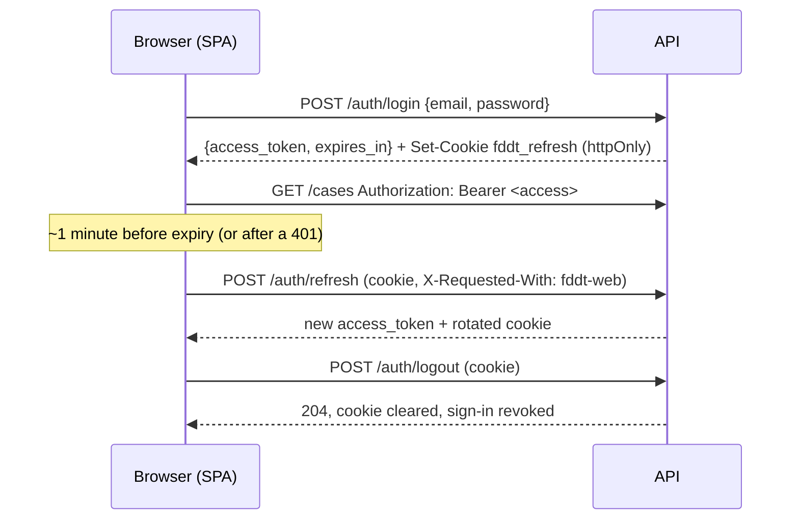

# Authentication & sessions

How a user signs in, how the session is kept, and what ends it. Code:
`backend/app/api/auth.py`, `backend/app/core/security.py`,
`backend/app/services/refresh_tokens.py`, `frontend/src/lib/session.ts`.

## Two tokens

| | Access token | Refresh token |
|---|---|---|
| What | JWT (HS256), signed with `JWT_SECRET_KEY` | 256-bit random string, opaque |
| Lifetime | `JWT_ACCESS_TOKEN_EXPIRE_MINUTES` (default **15**, max 60) | `REFRESH_TOKEN_IDLE_DAYS` without use (default 7), `REFRESH_TOKEN_ABSOLUTE_DAYS` per sign-in in any case (default 30) |
| Where the browser keeps it | **In memory only** (a module variable). Never `localStorage`/`sessionStorage` | **httpOnly, Secure, SameSite=Strict cookie** `fddt_refresh`, `Path=/api/auth`. Page scripts cannot read it; it is sent to the auth routes only |
| Sent as | `Authorization: Bearer …` on every API call | the cookie, to `POST /auth/refresh` and `POST /auth/logout` |
| Stored on the server | not stored | only its **SHA-256 hash** (`refresh_tokens` table) |

Access-token claims: `sub` (user id), `iat`, `nbf`, `exp`, `iss` (`JWT_ISSUER`), `aud`
(`JWT_AUDIENCE`), `jti`, `typ=access`, `ver` (the user's `token_version`), `role`, `company_id`,
`is_platform_admin`. Verification pins the algorithm (an `alg: none` or differently signed token is
refused), requires every one of those claims, and checks issuer and audience. The user is then
re-read from the database on every request: the account must be active, its company active, and its
company, platform-admin flag and `token_version` must still match the token.

## Flow

- **Page load:** the SPA has no token in memory, so it calls `/auth/refresh` first; with a valid
  cookie the user is still signed in, otherwise the sign-in screen shows.
- **Rotation:** every refresh revokes the presented refresh token and issues its successor in the same
  *family* (one family = one sign-in).
- **Reuse detection:** a refresh token that was already rotated and is presented again was copied.
  The whole family is revoked (thief and user both signed out) and a
  `refresh_token_reuse_detected` audit row is written. Exception: within
  `REFRESH_TOKEN_REUSE_GRACE_SECONDS` (20 s) of the rotation — two tabs refreshing at the same
  moment — the late request gets an access token and no new cookie. The SPA also serialises refreshes
  across tabs with a Web Lock, so this rarely happens at all.
- **Several tabs:** signing out in one tab signs out every tab (BroadcastChannel).

## What ends sessions

| Event | Effect |
|---|---|
| Sign out (`POST /auth/logout`) | This sign-in's refresh tokens revoked, cookie cleared; the in-memory access token is dropped |
| Sign out everywhere (`POST /auth/logout-all`, in the Change password dialog) | Every sign-in of the account revoked **and** every access token invalidated at once |
| Own password change | Everything revoked/invalidated; the current tab continues with the new tokens returned |
| Platform admin resets a password; changes a user's role, company or active flag | Everything of that user revoked/invalidated |
| Company suspended | Every request and refresh of its users refused |
| Idle / absolute lifetime reached | Refresh refused: sign in again |

"Invalidated at once" works through `users.token_version`: it is in every access token (`ver`), and
bumping it makes every token issued before stop working on its next request — no waiting for expiry.

## CSRF and other defences

- The refresh cookie is `SameSite=Strict` and scoped to `/api/auth`, so no other site can make the
  browser send it, and no other route ever receives it.
- `/auth/refresh` and `/auth/logout` additionally require the header `X-Requested-With: fddt-web`.
  A cross-site page cannot add a custom header without a CORS preflight, and this API allows no
  cross-origin requests. Every other route is authenticated by the Bearer header, which a browser
  never attaches on its own, so classic CSRF does not apply.
- Sign-in: unknown email, wrong password, inactive account and suspended company all give the same
  401 in the same time (a dummy bcrypt check runs for unknown emails); throttled per account and per
  IP (`backend/app/services/login_throttle.py`). Passwords are bcrypt-hashed; a password longer than
  1024 characters is refused before hashing.
- Auth responses carry `Cache-Control: no-store`. Every API response carries `nosniff`,
  `X-Frame-Options: DENY`, `Referrer-Policy: no-referrer` and `Cross-Origin-Resource-Policy:
  same-origin`. The web server adds HSTS, a framing/plugin/base-uri/form-action CSP and a
  Permissions-Policy (`frontend/nginx.conf.template`).
- Outside `ENVIRONMENT=local/dev/test` the API **refuses to start** if `JWT_SECRET_KEY` is the default
  or shorter than 32 characters. With `ENVIRONMENT=production` the interactive API docs (`/docs`,
  `/redoc`, `/openapi.json`) are off unless `API_DOCS_ENABLED=true`.
- Sign-ins (`user_signed_in`, with IP and browser), sign-outs everywhere, password changes and resets,
  and refresh-token reuse are audited.
- A daily housekeeping job (`purge_expired_refresh_tokens`) deletes refresh-token rows of sign-ins that
  ended more than 30 days ago.

## Deploying this change

- The migration `d7a2c4e9f1b6_refresh_tokens` adds `users.token_version` and `refresh_tokens`
  (granted to the platform DB role only). Tokens issued before it lack the new claims: **everyone
  signs in once more** after the deploy.
- Production must serve the SPA and the API from the same origin under `/api` (as the nginx template
  does), over HTTPS. Keep `REFRESH_COOKIE_SECURE=true` and `REFRESH_COOKIE_PATH=/api/auth`.
- Set `JWT_SECRET_KEY` to a random value of at least 32 characters (rotating it signs everyone out).

## Known limits

- HS256 with one shared secret: anything holding `JWT_SECRET_KEY` can mint tokens. Keep it in Key
  Vault only.
- No multi-factor authentication and no self-service password reset (a platform admin resets).
- The CSP does not yet restrict script/style/connect sources; tightening it needs an audit of what
  the SPA loads (pdf.js worker, blob/SAS URLs) and a browser test.
- The per-IP sign-in limit sees the client IP only when uvicorn trusts the proxy
  (`FORWARDED_ALLOW_IPS`); the per-account limit is the one relied on.
